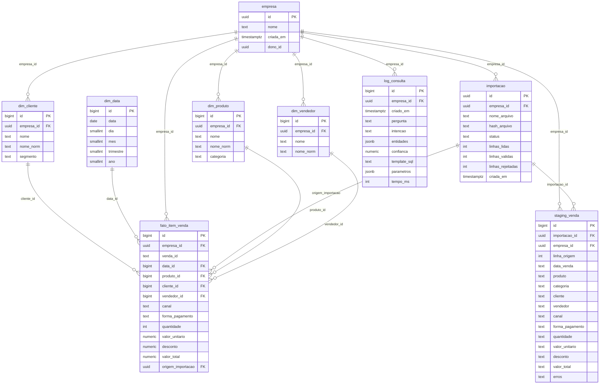

# DER — modelo de dados implantado (TC2 F07)

Gerado por introspecção do banco real (`scripts/gerar_der.py`), não um
diagrama de software. DDL versionado em `database/migrations/` (001 em diante;
as migrations 006 e 007 não mudam tabelas, só permissões, RLS e funções, então
o diagrama continua o mesmo).

- **Grão da fato (`fato_item_venda`): um ITEM de venda** (produto dentro de
  uma venda). `quantidade_vendas` usa `count(distinct venda_id)`; o ticket
  médio = faturamento / vendas distintas (ver sql/templates.py).
- **`empresa.dono_id`** referencia `auth.users` (gerido pelo Supabase, em
  outro schema), por isso essa relação não é desenhada aqui. Não há
  tabela `usuario` própria do projeto.



## Chaves e unicidade

| Tabela | PK | Unicidade |
|---|---|---|
| empresa | id | — |
| dim_data | id | (data) |
| dim_produto | id | (empresa_id, nome_norm) |
| dim_cliente | id | (empresa_id, nome_norm) |
| dim_vendedor | id | (empresa_id, nome_norm) |
| importacao | id | (empresa_id, hash_arquivo) |
| staging_venda | id | — |
| fato_item_venda | id | (empresa_id, venda_id, produto_id) |
| log_consulta | id | — |

## Figura do documento (TCC, Figura 4)

`der.png` é a imagem usada na Figura 4 do TCC. Foi gerada a partir do mesmo
Mermaid acima, convertido para Graphviz (`der.dot`) para caber em uma página A4
em formato retrato. Para regenerar:

```bash
dot -Tpng -Gdpi=300 docs/diagramas/der.dot -o docs/diagramas/der.png
```
